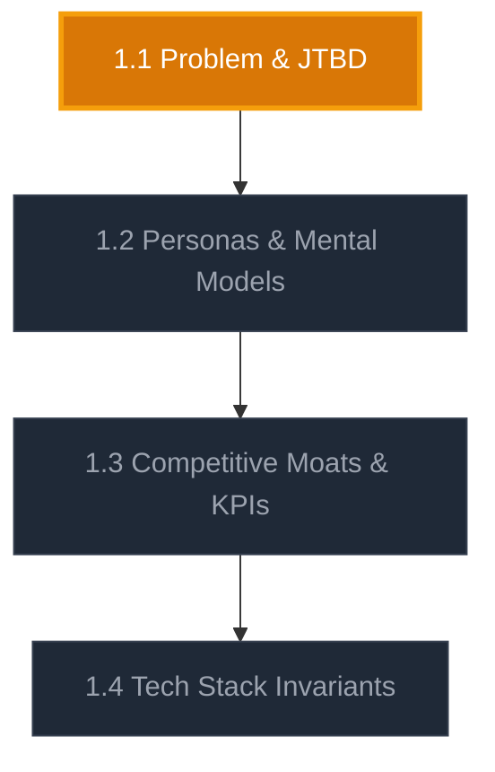

# [RESUME ANCHOR] {{PROJECT_NAME}}

> **Project Root**: `{{PROJECT_PATH}}`  
> **Last Synchronized**: `{{DATETIME}}`  
> **Active Stage**: Stage 1 (Problem Framing & UX Strategy)  
> **Active Sub-Phase**: Phase 1.1 (Problem Framing & Value Proposition)  
> **Active Chat Session**: Chat 01  
> **Status**: `[NOT STARTED]`  

---

## One-Line Prompt for New Chat Session

Whenever you open a fresh chat in your IDE, simply paste:

```markdown
Resume project at {{PROJECT_PATH}}. Read RESUME.md, run vibesec pre-flight, and execute the active phase.
```

---

## Active Phase Summary & Invariants

- **Active Sub-Phase**: `Phase 1.1 -- Problem Framing & Value Proposition`
- **Mandatory Pre-flight**: Run [`vibesec`](file:///d:/Design-OS/.agents/skills/vibesec/SKILL.md) security check.
- **Zero-Emoji Mandate**: Absolutely zero emojis across chat, code, and documentation. Use `[PASS]`, `[FAIL]`, `[ACTIVE]`.
- **Target Artifact**: `context/1-brand-and-vision.md`
- **Mandatory Skills**: [`design-brief`](file:///d:/Design-OS/.agents/skills/design-brief/SKILL.md), [`jobs-to-be-done`](file:///d:/Design-OS/.agents/skills/jobs-to-be-done/SKILL.md), [`workflow-frame-problem`](file:///d:/Design-OS/.agents/skills/workflow-frame-problem/SKILL.md), [`vibesec`](file:///d:/Design-OS/.agents/skills/vibesec/SKILL.md)
- **Allowed Write Paths**:
  - `context/1-brand-and-vision.md`
  - `specs/phase-1.1-spec.md`
  - `context/6-progress-tracker.md`
  - `RESUME.md`
  - `NEXT_CHAT_PROMPT.md`
- **Forbidden Write Paths**: `[src/**/*, index.html, context/2-design-tokens.json, context/3-ui-manifest.md]`

---

## Live Architecture Map Snapshot


*(For complete 24-phase map, see [`docs/DESIGN_MAP.mermaid`](file:///d:/Design-OS/{{PROJECT_PATH}}/docs/DESIGN_MAP.mermaid))*
