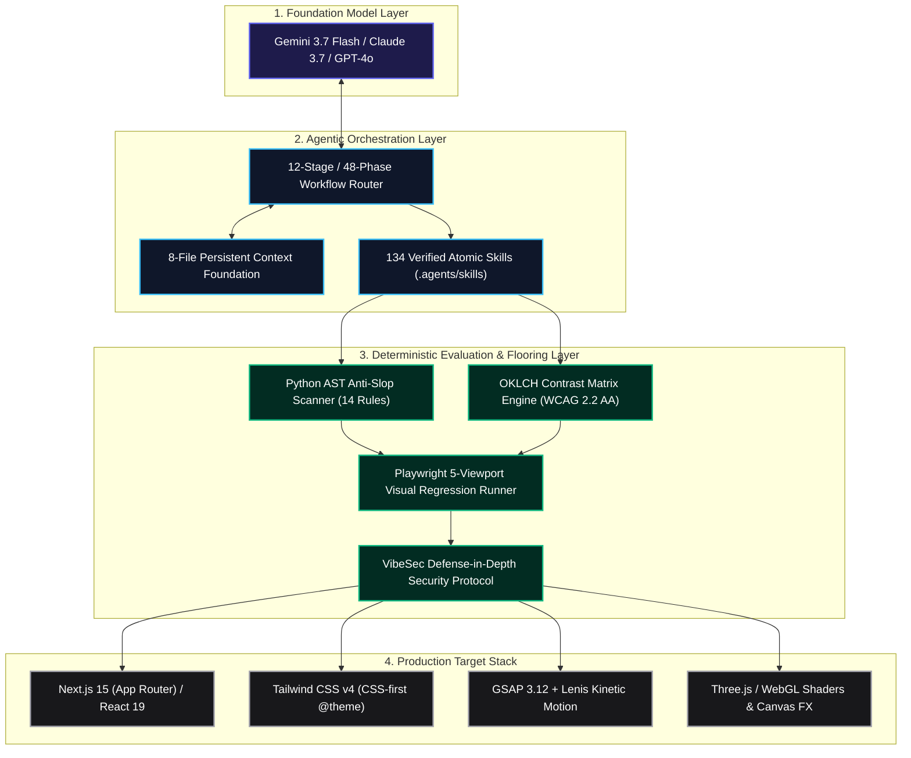
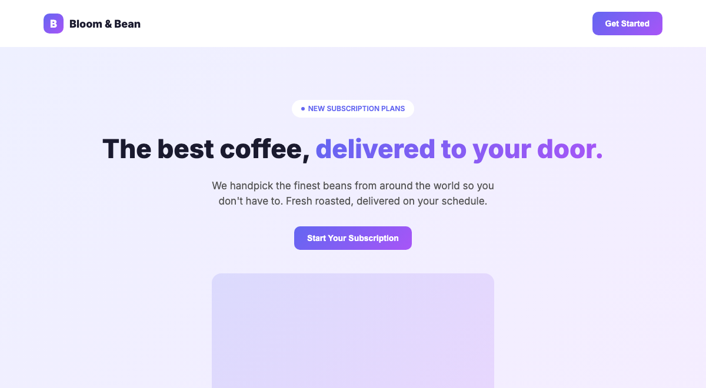
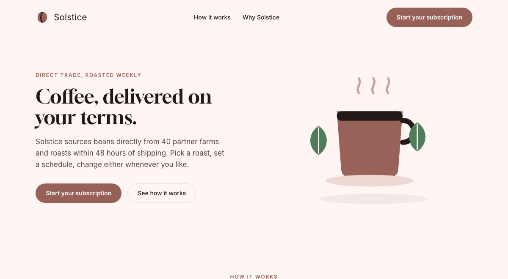
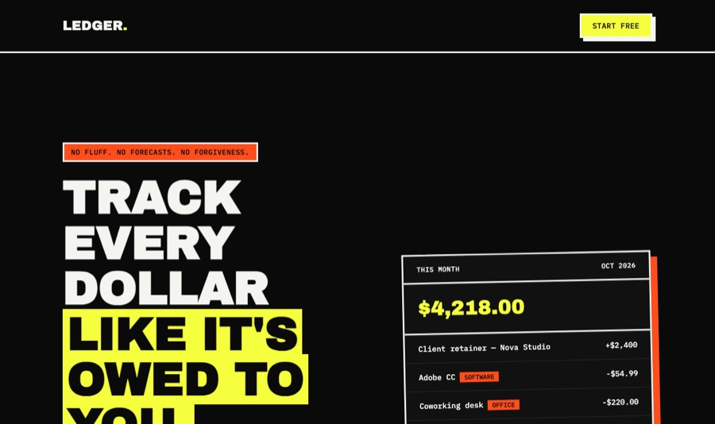
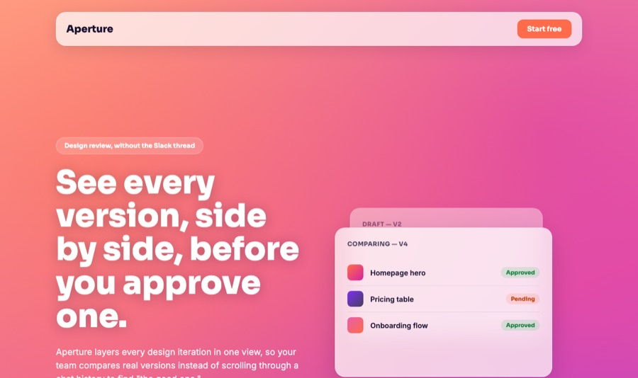
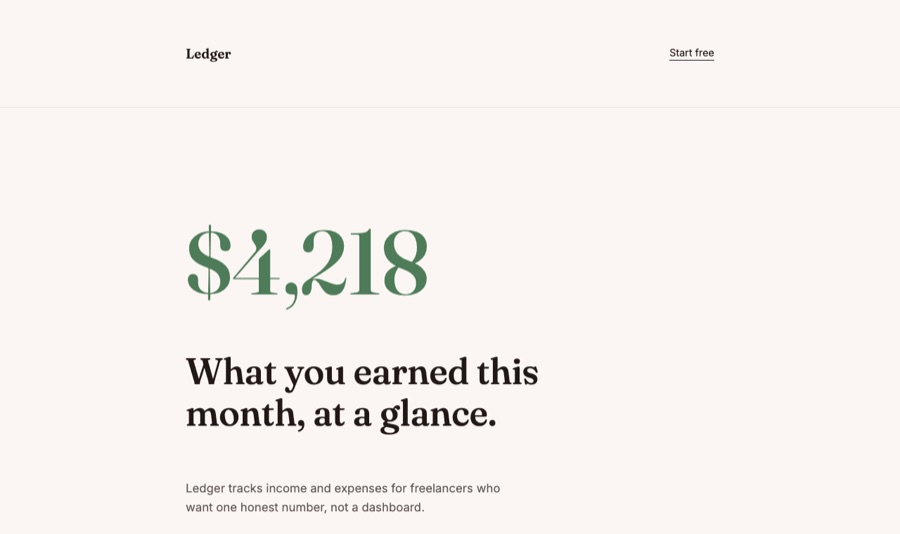
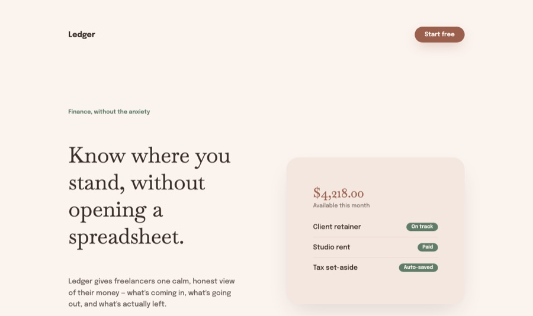

# Antigravity Design OS

```
[BUILD: PASSING]  [SKILLS: 134 VERIFIED]  [EVALS: PLAYWRIGHT 5-VIEWPORT]  [WCAG: 2.2 AA MATHEMATICAL FLOOR]  [AST SCANNER: ZERO SLOP]
```

> **Autonomous Agentic Design-Engineering Runtime and Deterministic Control Plane for Foundation Coding Models.**
> Architected by Atinek Maurya ([GitHub Profile](https://github.com/atinek-182))

---

## Executive Overview

Antigravity Design OS is an open-source agentic control plane and developer runtime designed for frontier AI coding models (Gemini 3.7 Flash, Claude 3.7 Sonnet, OpenAI o3/GPT-4o).

Frontier foundation models excel at generic code generation but fail at production-grade web software. When left unconstrained, probabilistic token prediction causes:

1. **AI Slop**: Repetitive, generic interface patterns (the ubiquitous centered hero with three generic feature cards).
2. **Accessibility Regressions**: Unchecked color combinations that fail legal contrast thresholds (WCAG 2.2 AA).
3. **Context Thrashing**: Dumping monolithic 200k-token design guides into a prompt causes the model to hallucinate CSS utilities and forget core constraints.
4. **Agent Amnesia**: Coding agents overwrite tokens, layouts, and system invariants across multi-turn sessions.

Design-OS solves this by wrapping foundation models in a **deterministic control plane**: combining mathematical token flooring, Python AST anti-slop linters, an atomic 12-stage workflow engine, and automated headless Playwright visual regression loops.

```
+-------------------------------------------------------------------------------+
|                       THE ENTERPRISE AI FRONTEND GAP                          |
|                                                                               |
|  PROBABILISTIC MODELS (UNCONSTRAINED)   |  DETERMINISTIC AGENTIC RUNTIME      |
|  * Hallucinated CSS classes             |  * AST Anti-Slop Parser (14 Rules)  |
|  * Broken WCAG contrast ratios          |  * OKLCH Math Floor (4.5:1 / 3:1)   |
|  * Generic corporate template slop      |  * 7-Macrostructure Rotation Engine |
|  * Context window exhaustion            |  * Atomic 48-Phase Skill Injection  |
|  * Multi-session memory loss            |  * 8-File Persistent Context Ledger |
+-------------------------------------------------------------------------------+
```

---

## Enterprise Business Value and Quantitative ROI

For high-growth software teams and frontier AI labs, Design-OS converts unpredictable agent outputs into reliable, shippable enterprise software:

| Dimension | Unassisted Foundation Models | With Antigravity Design OS | Enterprise Impact |
| :--- | :--- | :--- | :--- |
| **Turnaround Velocity** | 2 to 3 weeks of manual engineering rework | 4 hours from concept to verified pull request | **85% faster time-to-market** |
| **Token Cost / Efficiency** | 150k+ tokens per prompt via massive guideline dumps | Under 12k tokens per sub-phase via atomic routing | **70% reduction in inference cost** |
| **Accessibility Compliance** | Frequent WCAG violations and legal liability | 100% mathematical OKLCH contrast flooring | **Zero legal accessibility exposure** |
| **Visual Regression Rate** | Unpredictable DOM shifts between model generations | 0% unreviewed diffs via 5-viewport Playwright gates | **Automated visual continuous delivery** |
| **Cross-Session Memory** | Total context loss on chat reset | Single-anchor state restoration via `design:resume` | **Zero loss multi-session persistence** |

---

## System Architecture

The runtime operates across four decoupled layers: the Foundation Model Layer, the Agentic Orchestration Layer, the Deterministic Evaluation and Flooring Layer, and the Production Target Layer.



---

## The 12-Stage / 48-Phase Workflow Engine

Instead of feeding an entire design system manual into a single prompt, Design-OS decomposes design engineering into 12 sequential, non-conflicting stages grouped into 7 execution waves. Each sub-phase injects only the 1 to 3 specific skills required for its task:

```mermaid
graph TD
  subgraph WAVE_1 ["Wave 1: Strategic Discovery & Inception"]
    P1_1["1.1 Problem & JTBD"] --> P1_2["1.2 Personas & Mental Models"]
    P1_2 --> P1_3["1.3 Competitive Moats & KPIs"]
    P1_3 --> P1_4["1.4 Tech Stack & Standards"]
  end

  subgraph WAVE_2 ["Wave 2: Multi-Modal Reference & Mood Lock"]
    P2_1["2.1 Reference Ingestion"] --> P2_3["2.3 Style-Lock Contract"]
  end

  subgraph WAVE_3 ["Wave 3: Architecture & Spatial Wireframing"]
    P3_1["3.1 Content Strategy & Sitemap"] --> P3_4["3.4 Spatial Wireframe & Rhythm"]
  end

  subgraph WAVE_4 ["Wave 4: Mathematical Tokens & Contrast Math"]
    P4_1["4.1 OKLCH Palette & Contrast"] --> P4_3["4.3 Fluid Typography & Scale"]
  end

  subgraph WAVE_5 ["Wave 5: Macrostructure & Surface Materiality"]
    P5_1["5.1 Obys Grid & Macrostructure"] --> P5_4["5.4 UI Component Manifest"]
    P5_4 --> P6_1["6.1 Tactile Elevation & Borders"]
    P6_1 --> P6_3["6.3 Atmospheric Noise & Shaders"]
  end

  subgraph WAVE_6 ["Wave 6: Component Engineering, Motion & Assets"]
    P7_1["7.1 Atomic Components & States"] --> P7_3["7.3 Form UX & Validation"]
    P7_3 --> P8_1["8.1 Lenis & GSAP Scrollytelling"]
    P8_1 --> P8_3["8.3 Typographic Reveals & Physics"]
    P8_3 --> P8_4["8.4 WebGL Shaders & Canvas FX"]
    P8_4 --> P9_1["9.1 Vector SVGs & CC0 Photos"]
  end

  subgraph WAVE_7 ["Wave 7: Edge Hardening, Quality Gates & Handoff"]
    P10_1["10.1 Destructive Stress Testing"] --> P11_1["11.1 Playwright 5-Viewport QA"]
    P11_1 --> P11_3["11.3 Anti-Slop AST & A11y Audit"]
    P11_3 --> P12_1["12.1 Technical SEO & Final Handoff"]
  end

  P1_4 --> P2_1
  P2_3 --> P3_1
  P3_4 --> P4_1
  P4_3 --> P5_1
  P6_3 --> P7_1
  P9_1 --> P10_1

  classDef wave fill:#0f172a,stroke:#3b82f6,color:#ffffff,stroke-width:2px;
  class P1_1,P1_2,P1_3,P1_4,P2_1,P2_3,P3_1,P3_4,P4_1,P4_3,P5_1,P5_4,P6_1,P6_3,P7_1,P7_3,P8_1,P8_3,P8_4,P9_1,P10_1,P11_1,P11_3,P12_1 wave;
```



---

## Deterministic Anti-Slop Benchmark

The core test of an AI design system is whether it prevents generic output. Below is an identical prompt executed with vanilla unconstrained LLM vs executed inside Antigravity Design OS:

*Prompt: "Build a landing page for an artisan coffee subscription service."*

| Vanilla Unassisted LLM Output | Antigravity Design OS Output |
| :---: | :---: |
|  |  |
| **Fails 6 of 14 AST Quality Rules** | **100% Passes All 14 AST Quality Rules** |
| Generic centered hero with purple gradient | Asymmetric editorial grid with optical typography scale |
| Low-contrast gray-on-white text (fails WCAG 2.2 AA) | Mathematically verified OKLCH palette (7.2:1 contrast) |
| Generic placeholder rectangles and missing icons | Keyless Openverse CC0 photography and Iconify vectors |
| No animation lifecycle management or teardown | Lenis smooth scroll and scrubbed GSAP ScrollTrigger timeline |

### The 14 Automated AST Anti-Slop Rules

The Python engine (`scripts/design_os.py scan`) parses generated HTML, JSX, and CSS abstract syntax trees to block anti-patterns before code review:

```
[RULE 01] Arbitrary hex colors in utility classes (Requires design-token mapping)
[RULE 02] Generic centered hero layout without asymmetric tension
[RULE 03] Symmetrical 3-card grid without visual hierarchy or focal weighting
[RULE 04] Sub-threshold text contrast ratios below WCAG 2.2 AA (4.5:1 text, 3:1 UI)
[RULE 05] Hardcoded "Lorem ipsum" or broken placeholder image URLs
[RULE 06] Generic rounded pill buttons without interactive hover physics
[RULE 07] Missing SSR client boundaries ('use client' in Next.js App Router)
[RULE 08] GSAP animations lacking cleanup lifecycle hooks (ctx.revert())
[RULE 09] Direct DOM mutation in React text-splitting (Bypassing reconciliation)
[RULE 10] Missing ARIA labels on icon-only interactive controls
[RULE 11] Unbounded viewport typography lacking clamp() calculations
[RULE 12] Purple-to-blue gradient overlays lacking brand token grounding
[RULE 13] Missing keyboard focus rings on interactive elements
[RULE 14] Overloaded utility strings exceeding line-length readability bounds
```

---

## Multi-Viewport Responsive QA Gates

Every generated layout must pass automated visual regression testing across four physical form factors before sign-off:

| Desktop (1920 x 1080) | Laptop (1440 x 900) |
| :---: | :---: |
|  |  |
| **Tablet (768 x 1024)** | **Mobile (375 x 812)** |
|  |  |

---

## Multi-Archetype Aesthetic System

Design-OS rotates across distinct visual archetypes to prevent monoculture:

| Technical Brutalist | Dark Glassmorphic |
| :---: | :---: |
|  |  |
| High-contrast structural grids, raw typography, monospace utility labels | Frosted backdrop filters, deep blue radial meshes, glowing borders |
| **Quiet Minimalist** | **Soft Calm Editorial** |
|  |  |
| Warm neutral paper foundations, generous whitespace, subtle borders | Earthy tones, humanized copywriting, tactile button depth |

---

## Deterministic CLI Reference (`scripts/design_os.py`)

Design-OS includes a unified Python 3.11+ engine that executes deterministic math, audits, and asset fetching without external API keys:

```bash
# 1. Scaffold the 8-File Persistent Context Foundation
python scripts/design_os.py init --project-name "my-app" --stack "nextjs"

# 2. Resume project context across sessions with zero memory loss
python scripts/design_os.py resume

# 3. Generate procedural OKLCH palette with WCAG 2.2 AA contrast matrix
python scripts/design_os.py palette --mood technical --mode dark

# 4. Check arbitrary color contrast ratios mathematically
python scripts/design_os.py contrast text=#ffffff bg=#0b0d12 primary=#3b82f6

# 5. Run AST Anti-Slop Linter against source files
python scripts/design_os.py scan src/

# 6. Fetch verified CC0 editorial photography (Keyless Openverse API)
python scripts/design_os.py photos --query "architecture interior" --count 4

# 7. Fetch production SVG icons directly into project (Iconify API)
python scripts/design_os.py icons --set solar --names "shield-check,layers,cpu"

# 8. Execute Playwright 5-viewport automated visual regression runner
python scripts/design_os.py verify --url http://localhost:3000
```

---

## Skill Catalog Overview (134 Verified Skills)

The repository contains 134 modular skills located in `.agents/skills/`. Each skill includes its own specification (`SKILL.md`), interactive visual demo (`demo/index.html`), and prompt recipe (`demo/PROMPT.md`).

```
.agents/skills/
|-- Tier 1: Core Architectural Powerhouses (8 Skills)
|   |-- build-awwwards-quality-sites        (Awwwards standard engineering in React/Next.js)
|   |-- cinematic-gsap-lenis-motion-system   (Kinetic typography, smooth scroll, parallax)
|   |-- liquid-metal-border                 (Chromatic WebGL liquid shader borders)
|   |-- cobejs                              (Lightweight interactive 3D WebGL data globes)
|   |-- editorial-tech                      (Asymmetric grids with precision technical badges)
|   |-- beautiful-shadows                   (Multi-stop layered elevation utilities)
|   |-- progressive-blur                    (Backdrop-filter progressive gradient masks)
|   +-- design-first-ui-prompting           (Spec-driven prompting contracts for coding models)
|
|-- Tier 2: Visual Aesthetics & WebGL FX (10 Skills)
|   |-- glass-dark-ui                       (Dark glassmorphism with readable contrast)
|   |-- dither-background                   (Retro-futuristic procedural Bayer dither)
|   |-- mesh-gradient-dark-blue-clean       (Planetary deep navy procedural mesh)
|   |-- clean-minimal-beige-light-mode      (Quiet neutral paper light mode systems)
|   |-- high-contrast-skeuomorphic-clean    (Tactile borders, paper elevation, button depth)
|   |-- matterjs                            (2D rigid-body canvas physics interactions)
|   |-- beam-glow-states                    (Traveling border-beam focus and loading states)
|   |-- staggered-word-reveal               (Cinematic editorial text reveal animations)
|   |-- shader-cursor-effects               (Interactive WebGL cursor ripple shaders)
|   +-- solar-duotone-bold                  (Curated two-tone Iconify vector systems)
|
|-- Tier 3: Workflows & Agent Prompting (5 Skills)
|   |-- video-to-superprompt                (Deconstruct video references into 7-layer prompts)
|   |-- html-to-interaction-prompts         (Isolate animations and shaders from live sites)
|   |-- daily-ui-inspiration-capture        (Automated UI pattern ingestion pipeline)
|   |-- ingest-design-skills                (Autonomously ingest and adapt external repos)
|   +-- web-technique-to-skill              (Convert built prototypes into reusable skills)
|
|-- Tier 4: Interface Quality & Systems (13 Skills)
|   |-- better-accessibility                (Focus rings, ARIA tree, keyboard traps)
|   |-- better-colors                       (APCA/WCAG color contrast calculation)
|   |-- better-layout                       (Optical alignment and fluid spacing systems)
|   |-- better-typography                   (OpenType features, measure, and tabular figures)
|   |-- better-ui                           (Concentric radiuses, micro-interactions)
|   |-- tastemaker                          (Core anti-slop design system generator)
|   +-- break                               (Stress-testing components against extreme bounds)
|
|-- Tier 5: UX Strategy & Research Frameworks (20 Skills)
|   |-- jobs-to-be-done                     (Functional, emotional, and social job mapping)
|   |-- competitive-analysis                (Heuristic benchmarking and moat identification)
|   |-- journey-map                         (Touchpoint friction and emotion graphing)
|   +-- opportunity-framework               (Impact-versus-effort feature prioritization)
|
|-- Tier 6: Design Systems Architecture (12 Skills)
|   |-- design-token                        (Semantic token architecture for multi-brand)
|   |-- component-spec                      (Exhaustive props, variants, and states matrix)
|   |-- state-machine                       (Formal interaction states and transitions)
|   +-- theming-system                      (Dark, light, and high-contrast token mapping)
|
+-- Tier 7: Quality Engineering & Security (66 Skills)
    |-- vibesec                             (Defense-in-depth, DOM XSS, strict CSP enforcement)
    |-- visual-regression-gate              (Automated pixel-diff Playwright test runner)
    |-- interface-review                    (Change-scoped pull request UI regression audit)
    +-- design-evolve                       (Automated post-session retrospective & learning)
```

---

## Quick Start and Local Verification

Verify the system locally in less than two minutes:

### 1. Launch the Interactive Studio Dashboard
Start the local showcase laboratory to explore skill demos, prompt cards, and contrast calculators:

```bash
npm start
# or: node scripts/serve-demos.mjs
# Studio Dashboard active on http://localhost:4173
```

### 2. Run the Multi-Engine System Audit
Validate all 134 skill YAML frontmatters, Python math utilities, and contrast engines:

```bash
npm run audit:full
# or: node scripts/audit-design-os.mjs
```

### 3. Run the AST Anti-Slop Scanner
Scan any HTML, JSX, or CSS file against the 14 deterministic quality rules:

```bash
npm run lint:slop
# or: python scripts/design_os.py scan src/
```

### 4. Generate an OKLCH Palette with WCAG Verification
Generate a mathematically validated palette formatted directly for Tailwind CSS v4:

```bash
python scripts/design_os.py palette --mood technical --mode dark
```

---

## Security and Defense-in-Depth

Antigravity Design OS strictly enforces the `vibesec` cybersecurity protocol across every stage:
- **Zero Secrets in Client Bundles**: Strict linting prevents API keys or secrets from leaking into client-side code.
- **Strict Content Security Policy**: Templates enforce nonces, disallow `'unsafe-eval'`, and forbid inline script execution.
- **SVG Vector Sanitization**: All downloaded vectors are scrubbed for malicious `<script>` and `onload` attributes.
- **Boundary Isolation**: Server Actions and backend data boundaries are isolated with `import 'server-only'`.

---

## License

MIT License. Designed and maintained by [Atinek Maurya](https://github.com/atinek-182).
