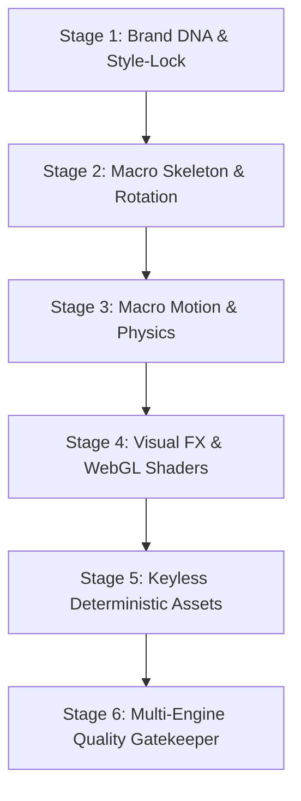

# Antigravity Design OS: System Architecture

The **Antigravity Design OS** is a universal design engineering repository and pair-programming system designed for high-end web design, Awwwards-tier interactions, WebGL shaders, cinematic motion, deterministic contrast math, and prompt engineering tailored for **Gemini 3.7 Flash (High)**.

---

## 1. High-Level Architecture

```
Antigravity Design OS
│
├── 1. Art Direction & Macro Layouts (Tier 1)
│   ├── Awwwards Quality Standards
│   ├── Asymmetric Editorial Tech Grids
│   ├── High-Conversion Landing & Pricing Pages
│   └── 2-Pass UI Prompting
│
├── 2. Motion & Scroll Storytelling (GSAP + Lenis Core)
│   ├── Synced GSAP RAF & Lenis Smooth Scroll
│   ├── Scrubbed ScrollTrigger Timelines
│   ├── Accessible Staggered Split-Text Reveals
│   └── Parallax & Pinned Storytelling
│
├── 3. WebGL, Shaders & Canvas FX (Tier 2)
│   ├── Chromatic Liquid Metal Borders (metal-fx)
│   ├── Interactive 3D Cobe.js Data Globes
│   ├── Rigid-Body 2D Physics (Matter.js)
│   └── Cursor Shader Ripple Overlays
│
├── 4. Visual Aesthetics & Mood Packs (Tier 2)
│   ├── Dark Glassmorphism (Glass Dark UI)
│   ├── Retro-Futuristic Ordered Dither
│   ├── Luminous Deep Blue Mesh Gradients
│   ├── High-Contrast Tactile Skeuomorphism
│   └── Quiet Minimal Beige Light Mode
│
├── 5. Micro-Interactions & Token Elevation
│   ├── Beautiful Layered Multi-Stop Shadows
│   ├── Progressive Blur Gradient Masks
│   ├── Conic & Linear CSS Border Gradients
│   ├── Dynamic Active Beam Glow States
│   └── Emil Kowalski Spring Physics & Apple Polish
│
├── 6. Deterministic Quality & Anti-Slop Engine (Tier 4)
│   ├── Tastemaker Core (Style-Lock & Memory Contract)
│   ├── Procedural Palette Engine & WCAG 2.2 AA Matrix
│   ├── Macrostructure Rotation Engine (7 Skeletons)
│   ├── Keyless CC0 Photo Stream (Openverse)
│   ├── AST Anti-Slop Scanner (14 Automated Rules)
│   └── Ideagram (Geometric Vector Marks & Branding)
│
├── 7. Autonomous Ingestion & Reverse-Engineering (Tier 3)
│   ├── Video to Superprompt (7-Layer Gemini Engine)
│   ├── HTML to Interaction SOP Deconstruction
│   ├── Live Website Scroll & Capture Loop
│   └── GitHub Repo Ingestion Engine (/ingest-design-skills)
│
└── 8. Platform Tooling & Automation
    ├── Interactive Studio Dashboard (Port 4173)
    ├── Multi-Engine Quality Auditor (npm run audit:full)
    ├── Automated Lockfile & Catalog Synchronizer
    └── YAML Frontmatter & Progressive Disclosure Linter
```

---

## 2. The 6-Stage Execution Pipeline



---

## 3. Progressive Disclosure Architecture

To prevent LLM context window bloat, Antigravity uses **Progressive Disclosure**:
1. **Context Initialization**: Only `name` and `description` from the YAML frontmatter of all 121 skills are loaded into the agent's available skills catalog.
2. **On-Demand Activation**: The full body of a `SKILL.md` (and any linked references in `references/`) is loaded into context **only when the agent or user invokes it**.
3. **Strict Conditional Triggers**: Every skill's description begins with an explicit `Use when...` trigger clause to prevent conflicting skill invocations.

---

## 4. Multi-Stack Code Standard

All skills in this Design OS are written with production-ready recipes for two primary stacks:

### A. React / Next.js (App Router)
- Explicit `'use client'` directives for interactive components.
- `useGSAP` or `useEffect` hooks with built-in context cleanup (`ctx.revert()`).
- SSR guards (`if (typeof window === 'undefined') return;`).
- Zero-dependency Tailwind v3/v4 utility classes and CSS modules.

### B. Vite (Vanilla/React)
- Standalone HTML5 semantic layout trees.
- High-performance ESM CDN imports (`https://cdn.jsdelivr.net/.../+esm`).
- Native CSS custom properties and cubic-bezier easing variables.
