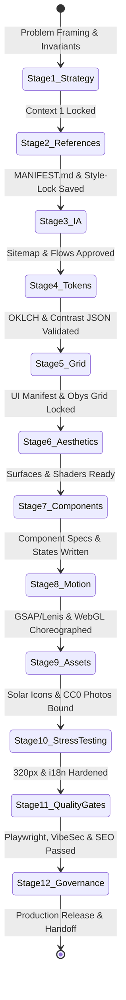

# Design OS Wayfinder & Multi-Session Navigational Road Map

> **Dynamic Visual State Chart, Execution Track Map, and Session Resume Protocol.**

---

## 📌 Global Project State
- **Project Name**: `[Project Name]`
- **Active Track**: `[--mode awwwards | --mode product | --mode component]`
- **Current Active Stage**: `[Stage 1 to 12]`
- **Current Sub-Phase**: `[Phase X.1 to X.4]`
- **Target Tech Stack**: `[React 19 / Next.js 15 / Vite / Astro / Pure HTML5/CSS / Svelte / Vue]`

---

## 🗺️ Cross-Session State Diagram

---

## ⚡ Session Handoff Checkpoints
- **Last Active Target Artifact**: `[e.g. context/4-motion-choreography.md]`
- **Pending Decision / Operator Sign-off**: `[e.g. Awaiting review of Playwright 5-viewport screenshots]`
- **Resume Protocol**: In any fresh session, run `/design-os resume` or `npm run design:resume` to reload this roadmap and `context/6-progress-tracker.md`.
